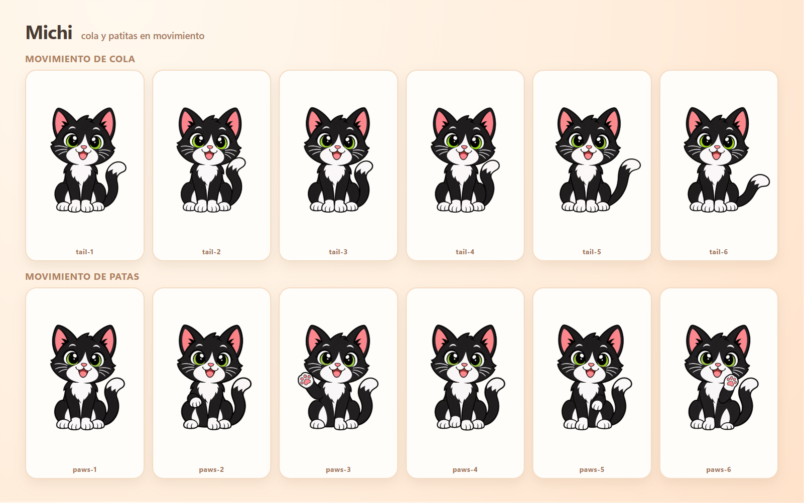

# Michi 🐾

Michi es una mascota virtual para Windows: un gato esmoquin kawaii que vive en tu
escritorio, mueve la cola, parpadea, te saluda con la patita y se echa siestas. Haz clic
en él para hablar y conectarlo a **Google Gemini** (o cualquier API compatible con OpenAI).
Además **te responde en voz alta** y puedes **hablarle por el micrófono**.



## Qué incluye

- **Mascota ilustrada** con cola en movimiento, parpadeo, saludo con la patita, ojos
  cerrados al dormir y una respiración sutil.
- **Expresiones**: alegría con destellos, curiosidad con interrogantes, sorpresa, tristeza
  y un balanceo suave mientras habla.
- **Tamaño compacto**: 116 px de gato.
- **Se queda donde la dejes**: sin paseos automáticos por el escritorio, pero sigue
  moviendo la cola, parpadeando, saludando y durmiendo si la dejas tranquila.
- **Arrástrala a cualquier posición**, incluso entre monitores. La posición se recuerda.
- **Chat con IA** con respuestas en streaming, historial persistente y personalidad configurable.
- **Voz**: Michi lee sus respuestas en voz alta con las voces de Windows y puedes
  dictarle por micrófono (Gemini, OpenAI o Groq).
- **Burbuja de diálogo** para leer sus respuestas sin abrir el chat.
- **Bandeja del sistema**, atajos globales e inicio automático con Windows.
- **Transparencia real por defecto**, con interruptor para usar la silueta recortada.
- **Buscador de actualizaciones** en Ajustes, con descarga e instalación desde GitHub.

## Requisitos

- Windows 10 u 11.
- Para desarrollo: Node.js 18 o superior.
- Una clave de API de Gemini (gratis en <https://aistudio.google.com/apikey>).

## Instalación y uso

```bash
npm install
npm start
```

La primera vez abre Ajustes con el engranaje ⚙ del chat (o clic derecho sobre la mascota →
**Ajustes…**), pega tu clave de Gemini, comprueba la conexión con **Probar conexión** y
guarda.

### Controles

| Acción | Cómo |
| --- | --- |
| Hablar con Michi | Clic en el gato (o doble clic en la bandeja) |
| Moverla | Arrastra el gato o la burbuja |
| Acariciarla | Doble clic en el gato |
| Dictarle por voz | Micrófono del chat (vuelve a pulsar para enviar) |
| Silenciar o activar la voz | Altavoz de la cabecera del chat |
| Menú rápido | Clic derecho sobre la mascota o la bandeja |
| Abrir/cerrar chat | `Ctrl + Shift + Espacio` |
| Mostrar/ocultar mascota | `Ctrl + Shift + M` |
| Cerrar el chat | `Esc` o la ✕ de la ventana |

Desde la bandeja también puedes **centrar la mascota**, hacerle cariño, mandarla a dormir,
silenciar la **voz** o activar **Iniciar con Windows**.

## Conectar la IA

Michi usa el formato de la API de OpenAI (`/chat/completions`), así que funciona con:

| Proveedor | URL base | Modelo de ejemplo |
| --- | --- | --- |
| Google Gemini | `https://generativelanguage.googleapis.com/v1beta/openai` | `gemini-2.5-flash` |
| OpenAI | `https://api.openai.com/v1` | `gpt-4o-mini` |
| OpenRouter | `https://openrouter.ai/api/v1` | `google/gemini-2.5-flash` |
| DeepSeek | `https://api.deepseek.com/v1` | `deepseek-chat` |
| Groq | `https://api.groq.com/openai/v1` | `llama-3.3-70b-versatile` |
| Ollama (local) | `http://localhost:11434/v1` | `llama3.2` |

En Ajustes puedes elegir el proveedor, la clave, el modelo y una personalidad libre
(por ejemplo, «sarcástica pero cariñosa»). La clave y el historial se guardan **solo en tu
equipo**, en `%APPDATA%\Michi\`:

- `config.json`: ajustes y clave de API.
- `history.json`: últimas conversaciones.

## Voz y dictado

**Hablar las respuestas** viene activado: Michi lee en voz alta cada respuesta cuando termina
de escribirla. Usa las voces instaladas en Windows, así que funciona sin conexión y no envía
el texto a ningún servicio.

En **Ajustes → Voz** puedes elegir la voz, la velocidad, el tono y el volumen, y escucharla con
**Probar voz**. El altavoz de la cabecera del chat (y el menú de la bandeja) silencian la voz
al instante. Si no hay ninguna voz en español, añádela en Windows:
**Configuración → Hora e idioma → Voz → Voz**.

El **micrófono** del chat graba unos segundos y envía el audio a tu proveedor de IA para
transcribirlo:

| Proveedor | Modelo de transcripción |
| --- | --- |
| Google Gemini | el mismo modelo configurado (`gemini-2.5-flash`) |
| OpenAI | `whisper-1` |
| Groq | `whisper-large-v3-turbo` |

Otros proveedores (DeepSeek, OpenRouter, Ollama) no ofrecen transcripción en esta versión.
La grabación se manda solo al proveedor elegido y no se guarda en disco. Puedes cancelarla
con `Esc`.

## Fondo transparente

Michi usa **transparencia real por defecto**: la mascota flota con bordes suaves y sombra.
Puedes desactivarla en **Ajustes → Fondo transparente** (o en el menú de la bandeja) para
usar el **modo silueta recortada** si tu equipo no compone bien la transparencia. Al cambiar
este ajuste, Michi se reinicia para aplicar el modo.

También se puede forzar manualmente:

```bash
npm start -- --transparent  # forzar transparencia real
npm start -- --solid        # forzar silueta recortada
```

Con la variable de entorno `MICHI_SOLID=0` (transparente) o `MICHI_SOLID=1` (silueta).

## Actualizaciones

La app incluye **Ajustes → Actualizaciones → Buscar actualizaciones**. El botón consulta
los GitHub Releases del repositorio, muestra la versión disponible y permite descargarla
e instalarla sin salir de Michi. El estado se muestra con progreso y avisos de error.

El flujo de publicación está automatizado con **GitHub Actions**
(`.github/workflows/release.yml`):

1. Sube la versión en `package.json` (por ejemplo, `1.3.0`).
2. Haz commit y push a `main`.
3. Crea y sube el tag de esa versión:
   ```bash
   git tag v1.3.0
   git push origin v1.3.0
   ```
4. El workflow compila con `electron-builder --publish always` y publica el **Release**
   con el instalador, `latest.yml` y el `.blockmap`.
5. La app instalada ya puede encontrar y aplicar la actualización desde Ajustes.

La primera versión con el actualizador (1.2.0) hay que instalarla manualmente; a partir de
ahí el botón funciona para las siguientes. También se puede publicar manualmente con un
token de GitHub:

```bash
set GH_TOKEN=tu_token
npm run dist -- --publish always
```

El instalador no está firmado con un certificado de código, así que Windows puede mostrar
avisos de SmartScreen. Para distribución pública conviene firmarlo.

## Crear el instalador

```bash
npm run dist    # instalador NSIS en dist/
npm run pack    # versión sin instalador en dist/win-unpacked/
```

El icono y el avatar se generan a partir del primer fotograma del gato:

```bash
npm run icons
```

## Estructura del proyecto

```
main.js                 Proceso principal: ventanas, bandeja, IA y persistencia
preload.js              Puente seguro entre Electron y las interfaces
src/main/ai.js          Cliente OpenAI-compatible con streaming y dictado
src/pet/                Ventana de la mascota (HTML/CSS/JS + motor de fotogramas)
src/pet/speech.js       Voz con la Web Speech API (voces de Windows)
src/chat/               Chat, ajustes y avatares
assets/gato-favorito/   Ilustraciones originales del gato (SVG y PNG fuente, no se empaquetan)
assets/gato-favorito/frames/  Fotogramas PNG con transparencia que usa la mascota
assets/avatar.png       Avatar para el chat
assets/icon.png/.ico    Icono de la aplicación
.github/workflows/      Publicación automática de releases
scripts/mock-ai.js      Servidor local de pruebas (IA simulada)
scripts/test-ai.js      Prueba del cliente de IA y del dictado
scripts/test-voice.js   Prueba de voz y de los controles del chat
```

## Pruebas

```bash
npm run test:ai     # streaming, errores y dictado con un servidor simulado
npm run test:voice  # voces de Windows, estado "speak" y controles de voz
```

También puedes levantar el servidor simulado y apuntar la app a `http://127.0.0.1:8787/v1`
con cualquier clave para ver el chat funcionando sin gastar cuota.

## Notas

- Las respuestas de la IA se piden en 1-3 frases para que quepan en la burbuja; el chat
  muestra el texto completo.
- El ánimo del gato se deduce de una etiqueta al principio de cada respuesta
  (`[feliz]`, `[curioso]`, `[cariñoso]`…), que no se muestra al usuario ni se lee en voz alta.
- Si la mascota se queda oculta detrás de otra ventana, la app la vuelve a subir
  periódicamente mientras **Siempre visible** esté activo.
- Proyecto personal, sin telemetría ni servicios propios: todo va de tu equipo al
  proveedor de IA que elijas.
